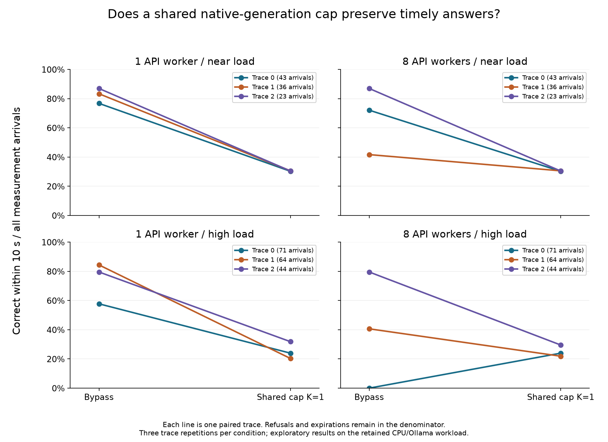

# Article evidence ledger

Evidence for the [published French article](https://beta.alien6.com/fr/research/articles/mise-en-production-ia-kubernetes/), which examines when scaling clients yields timely useful tasks and why correct shared-capacity accounting is not sufficient. The architectural boundary is between the client deadline, worker queue and provider-owned ledger. The [article data snapshot](https://github.com/Alien6-Studio/research-llm-kubernetes/tree/data-2026-11-15-article) preserves the evidence used for publication; this ledger also retains controls and historical observations beyond the article.

## Apparatus and hypotheses

Read [PROTOCOL.md](PROTOCOL.md) for H1 replicas/headroom, H2 quota counterfactuals, H3 admission, H4 real-model transfer. The collected primary emulator matrix has 72 trials; quota 12, provider-only 12, CPU 48 are separate controls, with their complete qualification blocks. Three trace repetitions are the experimental units. Emulator workload: 180/s regular Poisson or alternating 180/18/s bursts, 3 s warmup, 10 s cohort, 2 s deadline, 4 active slots +32 queue places/worker. The actual-model baseline has its own 335-second arrival cohorts, ten-second deadline, actual generation records and separate lifecycle regimes.

## Citable numerical findings

Every number in [RESULTS.md](RESULTS.md) is generated from the files below. A row in `analysis/v2-study/trials.csv` is one trial, never a request-level replication. The individual archive for a trial is located by `trial_id` in that dataset’s archive manifest; `source_relative_path` is the original collection path, not a download URL.

| Claim / source | Metric and denominator | Comparison and limits |
| --- | --- | --- |
| Replica curve: 18.87 / 39.63 / 76.27 / 170.73/s. `analysis/v2-linux-primary/results.json`, trials filtered profile=unlimited,policy=none | `useful_cohort_per_second`; useful/10s per trial; n = 3 paired repetitions, same arrival denominator retained | 1/2/4/8 workers; finite offered load, emulator only. All per-trial values and uncertainty are in `RESULTS.md` / `contrasts[]` |
| Replica curve: 19.60 / 25.20 / 25.10 / 25.47/s. `analysis/v2-linux-primary/results.json`, trials filtered profile=quota,policy=none | `useful_cohort_per_second`; useful/10s per trial; n = 3 paired repetitions, same arrival denominator retained | 1/2/4/8 workers; finite offered load, emulator only. All per-trial values and uncertainty are in `RESULTS.md` / `contrasts[]` |
| Correct accounting yet lost utility: 487/762 consumed tasks have no timely useful client outcome (63.91%). `analysis/v2-linux-primary/results.json` | Sum `consumed_without_timely_client_outcome` / sum `provider_consumed` across 3 quota/global/8 trials; this is a consumed-work denominator, not all arrivals | Compare quota/none/8 using the same fields and paired trace seeds; 4 held slots, 32-place queue, no deadline-feasibility scheduling |
| Quota movement: `analysis/v2-linux-provider-control/results.json` and `analysis/v2-linux-quota-sensitivity/results.json` | `useful_cohort_per_second`, useful/10s per trial; n = 3 per condition | Direct provider 20k/40k/80k versus unlimited; global-worker 20k/40k/80k. Emulator units, not LLM tokens; do not pool paths |
| CPU explanation: `analysis/v2-independent-cpu-sensitivity/results.json`; combined `contrasts[]` with question=`CPU sensitivity` | Paired 4→8 CPU differences at fixed profile/policy/replicas; n = 3 per contrast | Real 8-vCPU VM; fresh randomized CPU arms. Do not equate a nonsignificant difference with equivalence or pool with GitHub hardware |
| Deadline mechanism: `archives/v2-linux-primary/primary-a8cd65769fffe9cb.json.gz` / `unlimited:0:1776` | Queue 1.810s, admission 0.140s, provider HTTP 0.147s; one selected request out of 178 non-tail consumed-unsuccessful candidates | Post hoc median worker-duration illustration in one trial, not a prevalence estimate; client outcome on generator clock, stages on worker clock |

Every other citable comparison is in `analysis/v2-study/results.json`, `contrasts[]`: exact left/right filters, metric, three paired differences, mean, df 2 interval and prospective planning sensitivity. `RESULTS.md` prints all of them. Claim only the condition in that row. Request outcomes, stage times, status counts and resources are in dataset `trials[]`; raw records are under the matching `archives/v2-*/` directory. `v2.verify` replays those from the archives, not from handwritten summaries.

## Native inference: observed client outcomes and completion evidence

We measured direct Ollama calls and 1/2/4/8 Kubernetes application workers to distinguish an answer that eventually finishes from an answer that reaches its caller in time. The task classifies a supplied HTTP status into a short JSON label; it does not evaluate general reasoning or retrieval quality.

All 45 frozen conditions are retained: 44 have complete native-completion certificates and one has uncertain native completion. The certified trials archive 1,490 complete native response bodies. This is an evidence inventory, not a throughput estimate. All 28 previously unattempted conditions passed their individual integrity and completion checks.

The first 17 observations share one inference epoch; that original block remains unqualified. Each of the 28 additional observations starts after a proved process termination/restart and four separate technical warmup responses. The continuation retains 29 reset proofs, including its initial reset, and 112 technical warmup responses. It also passes three refreshed transport controls and all 12 qualification trials. These checks establish the observation apparatus; they do not turn the mixed-regime 45-row table into a qualified causal comparison.

Every primary fraction uses all planned measurement arrivals during 335 seconds after a five-second arrival warmup. A useful result is correct HTTP 200 within ten seconds of its scheduled arrival. A native response observed later, even HTTP 200 with `done=true`, never replaces the client outcome. Native completion, resource qualification and client usefulness remain separate fields.

The following examples use only the reset-per-trial regime. They illustrate the denominator and the observed variability; the full table retains every condition.

| Load / trace repetition | Path | Timely correct / measurement arrivals | Native completion |
| --- | --- | ---: | --- |
| low / 0 | Direct Ollama | 7 / 13 | certified |
| low / 0 | 1 application worker | 7 / 13 | certified |
| low / 0 | 2 application workers | 7 / 13 | certified |
| low / 0 | 4 application workers | 7 / 13 | certified |
| low / 0 | 8 application workers | 7 / 13 | certified |
| high / 0 | 1 application worker | 40 / 71 | certified |
| high / 0 | 2 application workers | 26 / 71 | certified |
| high / 0 | 4 application workers | 0 / 71 | certified |

The retained `real-model-high-0-0` observation has 73 expected native calls, 68 terminal records, 2 uncertain terminal outcomes and 5 active calls at capture. Its recorded client cohort remains visible. It was not rerun, replaced or relabelled as certified.

Different arrival seeds and inference lifecycle regimes are not pooled for means, confidence intervals, significance tests or replica-effect claims. In particular, a successful high-load observation in the original shared epoch is not a fair substitute for a missing reset-epoch comparison.

Sources: [all 45 observations and exact raw SHA values](analysis/v2-ollama-fra6s004-cpu-continuation/results.json), [trial CSV](analysis/v2-ollama-fra6s004-cpu-continuation/trials.csv), [immutable protocol and selected plans](protocol/ollama-fra6s004-cpu-continuation/manifest.json), and [lossless evidence index](archives/cpu-native-baseline/evidence-index.json). `python scripts/check_cpu_continuation.py` restores and replays the complete evidence offline, including every reset, warmup and native certificate.

These observations support examining how client deadlines, queued native work and admission decisions interact. The baseline uses policy=none and does not compare a new admission algorithm. No benefit of an Alien6 library, production SLO, monetary saving or general model-capability improvement is established.

## What a shared native-generation limit changed

We asked whether a common limit could preserve timely answers when application workers call the same CPU-hosted Ollama process. We compared bypass with one shared native-generation permit on identical arrival traces. The complete intervention combines K=1, immediate refusal when occupied, release only after successful native HTTP completion, and quarantine of uncertain completion. Both arms use the same instrument; every arm starts after certified process reset and four common technical warmup responses.

The collection on 15 November 2026 retains all 24 arms and 12 complete pairs. All client cohorts are observable; 24 arms have complete native-resource certificates. Fresh controls pass in all three network repetitions and all twelve generator trials. These checks are replayed from retained evidence, without Ollama.

The primary outcome is a correct response within ten seconds of its scheduled arrival, divided by every measurement arrival. Refusals, unissued requests and expired callers remain in that denominator. The table shows each of the three trace repetitions per worker/load condition; it does not pool requests or combine these data with the older 45-condition baseline.

| API workers / load / trace | Bypass: useful / arrivals | Shared K=1: useful / arrivals | Difference (percentage points) |
| --- | ---: | ---: | ---: |
| 1 / high / 0 | 41 / 71 | 17 / 71 | -33.80 |
| 1 / high / 1 | 54 / 64 | 13 / 64 | -64.06 |
| 1 / high / 2 | 35 / 44 | 14 / 44 | -47.73 |
| 8 / high / 0 | 0 / 71 | 17 / 71 | +23.94 |
| 8 / high / 1 | 26 / 64 | 14 / 64 | -18.75 |
| 8 / high / 2 | 35 / 44 | 13 / 44 | -50.00 |
| 1 / near / 0 | 33 / 43 | 13 / 43 | -46.51 |
| 1 / near / 1 | 30 / 36 | 11 / 36 | -52.78 |
| 1 / near / 2 | 20 / 23 | 7 / 23 | -56.52 |
| 8 / near / 0 | 31 / 43 | 13 / 43 | -41.86 |
| 8 / near / 1 | 15 / 36 | 11 / 36 | -11.11 |
| 8 / near / 2 | 20 / 23 | 7 / 23 | -56.52 |



Each line joins the two arms of one trace, using the same arrival denominator. Regenerate the SVG/PNG with `python scripts/plot_shared_admission.py`; rendering requires the optional analysis dependencies.

The shared cap increases timely correct responses in 1 pair and decreases them in 11. This sign tally describes the twelve observed contrasts; it is not a significance test or twelve independent replications of one common effect. At eight workers and high load, the direction changes between traces. At one worker, the shared cap also changes the concurrency budget: it is not a pure coordination-overhead control.

K=1 follows the frozen fallback rule applied to the earlier calibration: no tested concurrency met the ten-second empirical p95 criterion. It was never SLO-qualified. These observations do not support treating this fixed cap as a generally beneficial setting for the retained workload, and do not validate a dynamic or deadline-aware scheduler.

A client HTTP 429 does not alone identify a shared-cap refusal; worker-local refusals and the separate admission ledger must be distinguished. Native API counts and summed HTTP/permit lifetimes cover the whole trace, including arrival warmup. They are not measurement-arrival counts, CPU time, energy, or per-client wasted work. Any future uncertain native lifetime must remain censored rather than removed to select a favorable resource subset.

For a possible Alien6 component, the study supports keeping client usefulness, refusal, native completion and occupied capacity separately observable. It does not establish a production-library benefit. Choosing admission limits from workload and deadlines, or adding cancellation or queueing, remains an untested engineering hypothesis.

Sources: [all 24 arms and 12 paired differences](analysis/v2-ollama-shared-admission/results.json), [trial CSV](analysis/v2-ollama-shared-admission/trials.csv), [frozen protocol](studies/shared-admission/PROTOCOL.md), [selected plans](protocol/shared-admission/manifest.json), and [lossless evidence index](archives/shared-admission/evidence-index.json). Run `python scripts/check_shared_admission.py --mode final` to restore and replay this comparison offline.

## Historical excluded actual-model instruments

| Data | Metric / denominator | Allowed interpretation |
| --- | --- | --- |
| `analysis/v2-local-real-model/results.json`, `archives/v2-local-real-model/` |30/45 trials pass individual integrity gates; whole 45 excluded | Cannot select passing trials to claim real-model scaling. All generation bodies/token counts remain inspectable |
| `archives/v2-model-pilot/`, `protocol/v2-model/plan.json` |4 warmup +48 measured classifications; closed-loop 16 per concurrency 1/2/4; best observed 4.689/s | Load selection only; no qualified Kubernetes replica comparison |
| `archives/v2-remote-network/`, `archives/v2-remote-compressed-network/`, `archives/v2-remote-fixture-network/` |Three headroom traces per block; p95 latency ≤100 ms required in every repetition; all 3 blocks fail as a whole | Transport instrument unqualified despite timely emission/HTTP success. Metadata/fixture controls are not inference throughput; unique cause remains unidentified |
| `studies/autoscaling/PROTOCOL.md` and manifests |No completed HPA/KEDA measurement denominator | Prepared only |

## Additional excluded actual-model blocks

Every block below remains excluded as a whole. Passing individual trials from an incomplete or invalid block are not combined with another attempt, used for paired inference or substituted for its missing trials. These records document instrument or collection limits, not model-capacity estimates.

| Dataset | Archived trials | Individually passing | Complete block | Qualified block |
| --- | ---: | ---: | --- | --- |
| [v2-ollama-isolated-plain-real-model](analysis/v2-ollama-isolated-plain-real-model/results.json) | 29 | 29 | False | False |

Lossless observations and block status remain under the matching `archives/DATASET/` directory. An incomplete block does not establish a unique hardware, model, transport or scheduler cause.

## Code actually used

The exact measured source is preserved as inert bytes in `instruments/manifest.json`. Select the recorded source ID from a raw manifest. The following ledger conversion comes from the primary measured instrument; it is not hypothetical library code.

```python
def consume(self, identifier, units):
    with self.lock:
        now = self.clock()
        self._expire(now)
        reservation = self.reservations.get(identifier)
        if not reservation or reservation['state'] != 'reserved' or reservation['units'] != units:
            self._event('consume_refused', identifier, now, units=units,
                        state=reservation['state'] if reservation else 'unknown')
            return False
        reservation['state'] = 'consumed'
        window = self.windows[reservation['window']]
        window['consumed_units'] += units
        window['consumed_requests'] += 1
        self._event('consumed', identifier, now, window=reservation['window'], units=units)
        return True
```

`v2/service.py::invoke` in that same captured source records planned-arrival deadlines; `v2/analyze.py::summarize` recomputes timely useful results from archived client/provider/worker observations. Current code adds server-owned destination validation; no throughput observation is retroactively assigned to that security change.

## Figures, exact sources and commands

| Standalone SVG/PNG under `analysis/v2-study/` | Source in `analysis/v2-study/results.json` |
| --- | --- |
| `replicas-and-admission` | `datasets.v2-linux-primary.trials`, profile/policy/replicas/useful_cohort_per_second; show all 3 repetitions |
| `quota-counterfactual` | provider-only/quota-sensitivity datasets, condition quotas; n = 3 per arm |
| `cpu-counterfactual` | paired CPU sensitivity contrasts, df 2 intervals; no equivalence claim |
| `deadline-and-quota-consumption` | primary quota/8 none/global; provider_consumed,useful,late consumption plus rule-selected illustration |

```sh
python scripts/check_cpu_continuation.py --restore-only
python -m unittest discover -p "test_*.py"
python scripts/verify_evidence.py
python -m v2.verify
python scripts/check_cpu_continuation.py
python -m v2.report --check
python -m v2.publication --check
python -m pip install -r requirements-analysis.txt
python -m v2.report --figures --output /tmp/study-figures
```

No Kubernetes or model server is needed for these calculations. The [reproduction guide](docs/REPRODUCING.md) includes the complete native-admission replay, optional figure rendering and separate collection instructions. New collection must use a fresh directory and complete qualification; captured protocols remain unchanged.

## Interpretation boundary and untested work

**Established within this emulator apparatus:** headroom permits useful replica scaling; changing a shared quota moves the limitation; an atomic provider ledger alone does not guarantee useful scheduling. **Observed in the native baseline:** 45 retained client cohorts, 44 complete native certificates and one preserved uncertain observation; the 28 reset-epoch observations are individually certified. **Exploratory:** numerical effect sizes and 3-repetition intervals in the qualified emulator apparatus; CPU sensitivity and finite resource-integral comparisons. **Not demonstrated:** transfer of quota/admission effects to real LLM inference; pooled replica effects across lifecycle regimes; steady-state production sizing; HPA/KEDA benefit; ROI, energy saving or HA.

Deadline-aware admission that coordinates provider budget, queue capacity and client deadlines remains untested. The current negative policy comparison does not demonstrate a benefit from an unimplemented component. A subsequent comparison would need identical traces, quotas and deadlines, complete qualification, useful-arrival outcomes and wasted-work accounting. It is separate from the published article.

**Disallowed formulations:** extra pods never help; global admission always improves reliability; CPU/network can never limit; emulator quota units equal actual model tokens; eventual HTTP200 equals a useful client result; three trial repetitions prove a universal law; prepared HPA/KEDA manifests are measured results.

## Primary method references and licensing

- Kubernetes resource management: https://kubernetes.io/docs/concepts/configuration/manage-resources-containers/ — resource requests/limits and CPU throttling.
- Kubernetes HPA: https://kubernetes.io/docs/tasks/run-application/horizontal-pod-autoscale/ — controller semantics only; no HPA outcome in this study.
- Ollama API and model controls: https://docs.ollama.com/api and https://docs.ollama.com/faq — raw version/digest/options in the archive override mutable model tags.
- Little, 1961, queueing relation: https://doi.org/10.1287/opre.9.3.383 — a theoretical context, not proof of stationarity or a fit to these short experiments.
- Apache-2.0 original code/docs; upstream images/tools/model weights retain their licenses; no model weights or customer deliverables bundled. See `THIRD_PARTY_NOTICES.md`.

References explain methods, not independent corroboration of this experiment’s numbers.

## Exact remote qualification observations

Source per block: `archives/BLOCK/control.json.gz`. Each row is one headroom repetition; transport timing, not model inference. The p95 latency gate is100ms and emission-lag gate50ms; every repetition must pass.

| Block | Repetition | Request denominator | p95 latency(ms) | p95 emission lag(ms) | Passed |
| --- | ---: | ---: | ---: | ---: | --- |
| v2-remote-network | 0 | 392 | 434.15 | 4.07 | False |
| v2-remote-network | 1 | 325 | 618.81 | 3.80 | False |
| v2-remote-network | 2 | 336 | 1061.10 | 3.97 | False |
| v2-remote-compressed-network | 0 | 392 | 99.08 | 3.83 | True |
| v2-remote-compressed-network | 1 | 325 | 129.04 | 4.03 | False |
| v2-remote-compressed-network | 2 | 336 | 182.82 | 4.06 | False |
| v2-remote-fixture-network | 0 | 392 | 118.12 | 4.11 | False |
| v2-remote-fixture-network | 1 | 325 | 108.86 | 4.04 | False |
| v2-remote-fixture-network | 2 | 336 | 135.36 | 4.00 | False |
