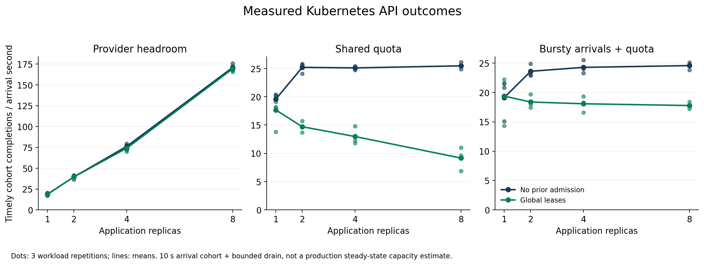

# Kubernetes client capacity for LLM applications

[](https://github.com/Alien6-Studio/research-llm-kubernetes/actions/workflows/ci.yml)
[](LICENSE)

We study the difference between work an inference provider completes and correct
answers that reach a client before its deadline. Application workers, shared
provider capacity and the organization of waiting are measured separately.

Read the published French article:
[Kubernetes : quand une régulation correcte dégrade les performances](https://beta.alien6.com/fr/research/articles/mise-en-production-ia-kubernetes/).
The [article data snapshot](https://github.com/Alien6-Studio/research-llm-kubernetes/tree/data-2026-11-15-article)
preserves the source and evidence available at publication.

## Main findings

In the emulator, at eight application workers and a shared quota of 40,000 units
per second, the tested blocking reservation policy reduces the mean useful rate
from **25.47 to 9.17 answers per second**. Waiting for a reservation occupies an
active worker slot. Correct atomic quota accounting does not establish that the
request can still finish before its deadline. The units belong to the simulation;
they are not measured LLM tokens.

In a separate CPU-hosted Qwen experiment, a shared **K=1** native-generation limit
with immediate refusal produces fewer timely correct responses in **eleven of
twelve pairs**, and more in one. This is an exploratory comparison of a fixed
policy with three trace repetitions per worker/load condition. K=1 was not shown
to be optimal or to satisfy the client deadline. These observations establish no
general benefit or harm from global admission control.

## Read the evidence

| Evidence set | Status and entry point |
| --- | --- |
| Emulator and resource controls | Qualified 72-trial matrix, quota counterfactuals and 48 CPU-sensitivity trials with paired 4/8 CPU comparisons. [Results](RESULTS.md), [condition tables](analysis/v2-study/tables.md), [trial CSV](analysis/v2-study/trials.csv), [derived analysis](analysis/v2-study/results.json). |
| Paired native admission | All 24 trials and their completion checks are retained. [Protocol](studies/shared-admission/PROTOCOL.md), [twelve pairs](analysis/v2-ollama-shared-admission/results.json), [trial CSV](analysis/v2-ollama-shared-admission/trials.csv), [lossless index](archives/shared-admission/evidence-index.json). |
| Earlier native CPU baseline | All 45 planned conditions remain visible: 44 certified completions and one uncertain completion. The original 17 observations and 28 reset-per-trial continuation observations use different lifecycles; their combined table is descriptive, not a qualified causal comparison. [Report](analysis/v2-ollama-fra6s004-cpu-continuation/results.json), [trial CSV](analysis/v2-ollama-fra6s004-cpu-continuation/trials.csv), [lossless index](archives/cpu-native-baseline/evidence-index.json). |

Start with [interpretation boundaries](VALIDITY.md), the [protocol](PROTOCOL.md),
the [article evidence ledger](ARTICLE_EVIDENCE.md) and the [evidence index](EVIDENCE.md).
Native completion and a correct response received within a client's deadline
remain separate outcomes; a late answer never improves the client score.



## Reproduce the calculations

Python 3.12's standard library is sufficient for the tests and numerical checks
below. Allow loopback sockets for HTTP integration tests. These commands replay
retained evidence; they do not launch a model or Kubernetes experiment.

```bash
python3 scripts/check_cpu_continuation.py --restore-only
python3 scripts/check_shared_admission.py --restore-only
python3 -m unittest discover -p 'test_*.py'
python3 scripts/analyze_calibration.py --check
python3 scripts/analyze_focused.py --check
python3 scripts/verify_evidence.py
python3 -m v2.verify
python3 scripts/inventory_legacy_evidence.py --check
python3 scripts/check_cpu_continuation.py
python3 scripts/check_shared_admission.py --mode final
python3 -m v2.report --check
python3 -m v2.publication --check
```

[The reproduction guide](docs/REPRODUCING.md) explains the checks, figure
regeneration, captured source identities and the separate procedure for collecting
a new campaign. [Benchmark V2](v2/) contains the measurement and replay code.

## Historical evidence and future studies

The [archive guide](archives/README.md) identifies retained observations and their
role. Failed blocks, original exclusions, executed source bytes and their hashes
remain inspectable. Earlier [calibration](CALIBRATION_RESULTS.md),
[focused controls](FOCUSED_RESULTS.md) and [captured methods](archives/legacy-methods/)
document how the instrument was qualified; they do not replace the current
interpretation boundaries.

[Autoscaling](studies/autoscaling/PROTOCOL.md) is a prepared study whose metric
exporter and controllers are not yet qualified. No HPA/KEDA or production-library
benefit has been measured. Future collection must use new observation paths and
preserve the registered methods and status of earlier evidence.

Code, documentation and figures are in English. This repository contains public
research evidence, not customer deliverables. See [contributing](CONTRIBUTING.md)
and [third-party notices](THIRD_PARTY_NOTICES.md).
