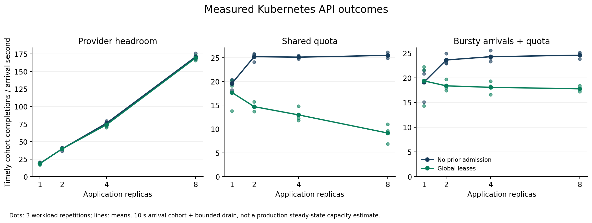

# Kubernetes client capacity for LLM applications

[](https://github.com/Alien6-Studio/research-llm-kubernetes/actions/workflows/ci.yml)
[](LICENSE)

An empirical study of application replicas, shared inference capacity and
admission policy. More replicas help when the dependency has headroom. A quota
changes that relationship, and correct quota accounting alone does not ensure
that answers reach clients before their deadline.

The complete 72-trial emulator matrix, quota counterfactuals and 48 paired CPU
controls are collected. The real-model question remains open: the entire local
45-trial block is excluded and the independent continuation fails its network
gate. No HPA/KEDA comparison has been measured. These are exploratory finite
workload observations, not a production capacity guarantee.

## Read the study

| Deliverable | Purpose |
| --- | --- |
| [VALIDITY.md](VALIDITY.md) | Interpretation boundary, exclusions and competing explanations |
| [PROTOCOL.md](PROTOCOL.md) | Hypotheses, frozen matrices, exclusions and prospective continuations |
| [Benchmark V2](v2/) | Async measurement, atomic leases, Kubernetes orchestration and offline replay |
| [RESULTS.md](RESULTS.md) | Actual outcomes, uncertainty, negative results, resources and limits |
| [ARTICLE_EVIDENCE.md](ARTICLE_EVIDENCE.md) | Supported statements and open questions for future writing |



[Evidence index](EVIDENCE.md) · [All condition tables](analysis/v2-study/tables.md) ·
[Trial CSV](analysis/v2-study/trials.csv) · [Full derived analysis](analysis/v2-study/results.json)

## Reproduce the calculations without a cluster or model

Python 3.12's standard library is sufficient for tests and numerical analysis.
Loopback sockets must be allowed for HTTP integration tests.

```bash
python3 -m unittest discover -p 'test_*.py'
python3 scripts/analyze_calibration.py --check
python3 scripts/analyze_focused.py --check
python3 scripts/verify_evidence.py
python3 -m v2.verify
python3 -m v2.report --check
python3 -m v2.publication --check
```

`v2.verify` checks compressed/decoded archive hashes, byte-identical workloads,
individual timings, lease conservation, classifications, transport controls and
committed numerical analyses. CI replays evidence and builds images; it does not
rerun Kubernetes/model experiments or establish scientific validity.

To regenerate one analysis and the standalone figures:

```bash
python3 -m v2.analyze archives/v2-linux-primary --out analysis/v2-linux-primary/results.json
python3 -m venv .venv
. .venv/bin/activate
pip install -r requirements-analysis.txt
MPLCONFIGDIR=/tmp/alien6-mpl python3 -m v2.report --figures
```

Rendering libraries are optional and are not installed in measured service
images. PNG/SVG figures come from archived request outcomes; they contain no
invented benchmark points.

## Collect a new campaign

Read the protocol and predeclare new source, trace, image and environment
identities first. Use a new output directory: never replace an earlier run.
A complete invalid block remains excluded; do not select its passing trials.

Docker, kind 0.32.0 and kubectl 1.36.1 are needed. The V2 cluster is isolated as
`a6-capacity-v2`, with its own ignored kubeconfig; do not use an application
cluster or change the normal Kubernetes context. Example emulator setup:

```bash
kind create cluster --config v2/kind.yaml --kubeconfig .kubeconfig-capacity-v2
IMAGE="alien6-capacity:v2-$(git rev-parse --short=12 HEAD)"
docker update --cpus 4 --memory 8g --memory-swap 8g a6-capacity-v2-control-plane
docker build -f v2/Dockerfile --build-arg SOURCE_COMMIT="$(git rev-parse HEAD)" -t "$IMAGE" .
kind load docker-image "$IMAGE" --name a6-capacity-v2
python3 -m v2.run deploy --image "$IMAGE"
kubectl --kubeconfig .kubeconfig-capacity-v2 -n a6-capacity-v2 port-forward --address 127.0.0.1 service/controller 18082:8080
```

Keep the forward in another terminal. Run the complete qualification before a
comparison, using fresh output paths and the exact built image:

```bash
python3 -m v2.run block --block calibration-4 --image "$IMAGE" --out runs/my-calibration-4
python3 -m v2.run block --block primary --image "$IMAGE" --out runs/my-primary
```

The 8 CPU campaign requires a host that really supplies 8 CPU and both qualifications.
[VM provisioning](infra/create-research-vm.sh), [bootstrap](infra/bootstrap-research-vm.sh)
and [CPU orchestration](infra/run-cpu-controls.sh) document the separate VM path.
They are operational scripts for an explicitly authorized isolated VM, not
commands to run on a shared hypervisor without checking their scope.

The native model setup, exact digest/options and failed local/remote qualification
are documented in the protocol and results. Keep installed weights and the
existing 11434 service separate from the dedicated 11435 study server. The remote
helpers require an explicitly configured private SSH path, observer and bridge;
they must never expose a model API publicly or substitute a transport fixture
for actual generation. Do not launch model comparisons after a failed gate.

[Autoscaling](studies/autoscaling/PROTOCOL.md) is a separate prepared study; its
metric exporter/controllers are not yet qualified. The historical `run.py`
autoscaler remains an experimental prototype.

## Retained evidence and scope

`archives/` contains lossless individually hashed observations, including failed
blocks. `analysis/` contains deterministic derived outcomes. Raw working `runs/`
are local collection files; V2 publication uses their lossless archives. Captured
protocols, executed source bytes, pilot exclusions and 12 November analyses remain available independently of Git ancestry.
See [PROTOCOL.md](PROTOCOL.md), [VALIDITY.md](VALIDITY.md),
[CALIBRATION_RESULTS.md](CALIBRATION_RESULTS.md), [FOCUSED_RESULTS.md](FOCUSED_RESULTS.md)
and the captured methods in `archives/legacy-methods/`.

Code, documentation and figures are in English. This public repository contains
research evidence, no customer deliverables. The Alien 6 site and article are not
modified by this study.

`instruments/manifest.json` preserves executed source identities. The current
network allowlist is a security correction for future collection, not a re-run
of the experiments. Materialize captured source into a fresh directory with
`python3 scripts/materialize_instrument.py SOURCE_ID /tmp/empty-instrument-directory`.
Raw observations never acquire the corrected source's identity retroactively.
