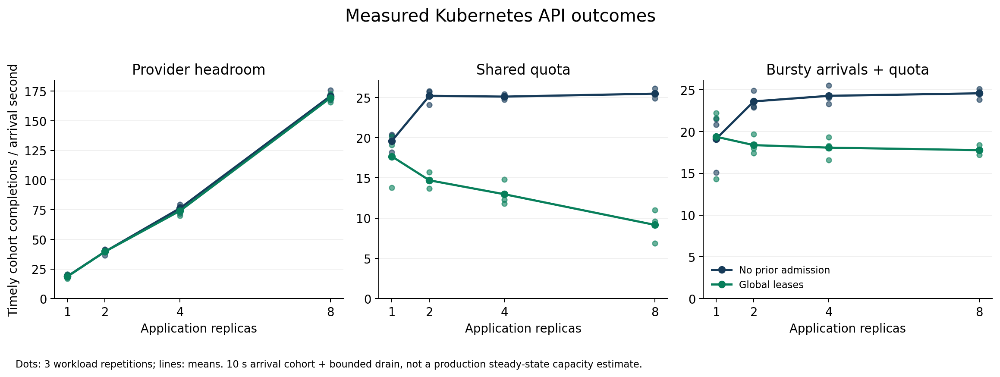
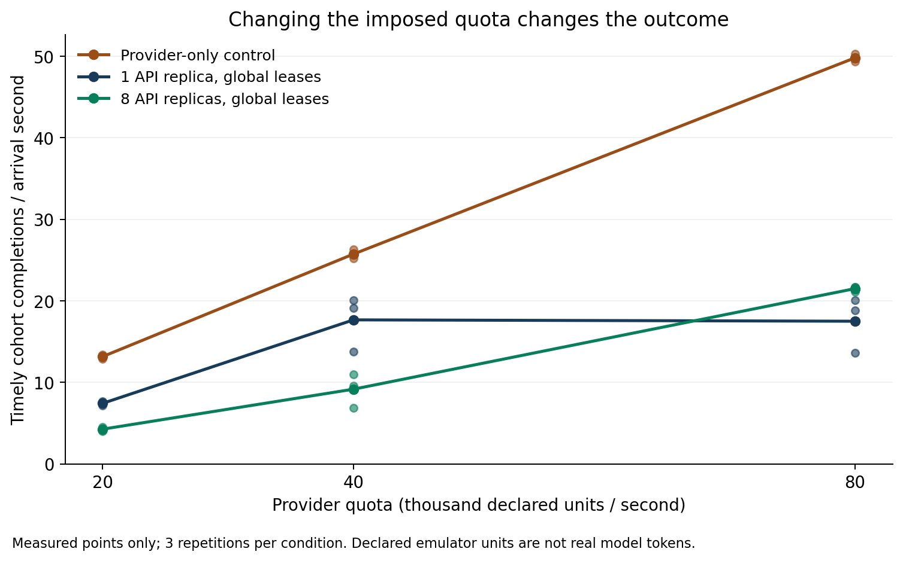
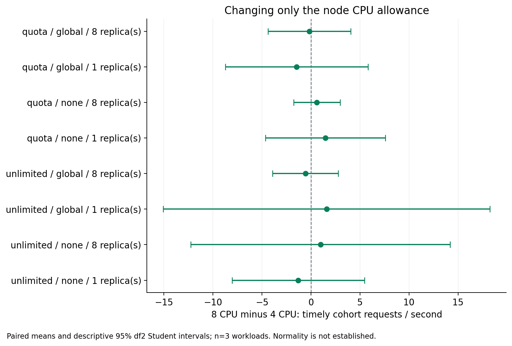
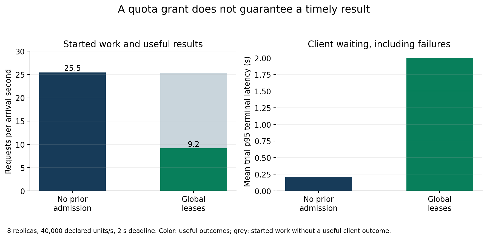

# Measured capacity, admission and validity results

Generated by `python -m v2.publication` from the stored observations and their replayed analyses.

## Scope and complete blocks

Replicas increase useful outcomes while the emulator has headroom. A shared quota reduces that benefit. The tested atomic global policy accounts correctly for capacity yet can worsen client outcomes. These are exploratory finite-workload observations. Transfer to actual LLM inference is **not demonstrated**.

| Dataset | Complete trials | Passing trials | Included for inference |
| --- | ---: | ---: | --- |
| v2-independent-calibration-4 | 12 | 12 | True |
| v2-independent-calibration-8 | 12 | 12 | True |
| v2-independent-cpu-sensitivity | 48 | 48 | True |
| v2-linux-calibration-4 | 12 | 12 | True |
| v2-linux-primary | 72 | 72 | True |
| v2-linux-provider-control | 12 | 12 | True |
| v2-linux-quota-sensitivity | 12 | 12 | True |
| v2-local-calibration-4 | 12 | 7 | False |
| v2-local-calibration-8 | 12 | 5 | False |
| v2-local-model-qualification | 12 | 12 | True |
| v2-local-real-model | 45 | 30 | False |
| v2-model-control-interruption | 0 | 0 | False |

A failed technical trial excludes the complete block, not only that trial. The native pilot and remote transport controls are separate from these trial datasets; see the evidence ledger and validity discussion. All raw failures are retained.

## Primary emulator outcomes

Useful means a correct HTTP200 result before the planned-arrival deadline. Rate is useful arrivals in a 10-second measurement cohort, followed through their deadline, divided by 10. Completion-window throughput counts finishes during the window separately. Four active slots and 32 queue places per worker; deadline 2 s. Declared quota units are not model tokens. Three paired seeded trace repetitions per condition.

| Profile | Policy | Replicas | Useful/s: each trial | Mean useful/s | Mean useful fraction |
| --- | --- | ---: | --- | ---: | ---: |
| unlimited | none | 1 | 20.30 / 18.10 / 18.20 | 18.87 | 10.72% |
| unlimited | none | 2 | 41.10 / 36.40 / 41.40 | 39.63 | 22.55% |
| unlimited | none | 4 | 77.60 / 71.80 / 79.40 | 76.27 | 43.39% |
| unlimited | none | 8 | 175.70 / 169.10 / 167.40 | 170.73 | 97.04% |
| unlimited | global | 1 | 18.50 / 20.40 / 16.90 | 18.60 | 10.56% |
| unlimited | global | 2 | 39.50 / 39.30 / 40.00 | 39.60 | 22.52% |
| unlimited | global | 4 | 76.50 / 69.90 / 75.80 | 74.07 | 42.12% |
| unlimited | global | 8 | 172.80 / 169.10 / 165.50 | 169.13 | 96.13% |
| quota | none | 1 | 20.40 / 18.20 / 20.20 | 19.60 | 11.15% |
| quota | none | 2 | 24.10 / 25.70 / 25.80 | 25.20 | 14.33% |
| quota | none | 4 | 25.20 / 25.40 / 24.70 | 25.10 | 14.27% |
| quota | none | 8 | 26.10 / 24.90 / 25.40 | 25.47 | 14.48% |
| quota | global | 1 | 19.10 / 20.10 / 13.80 | 17.67 | 10.01% |
| quota | global | 2 | 13.70 / 14.70 / 15.70 | 14.70 | 8.37% |
| quota | global | 4 | 14.80 / 12.30 / 11.80 | 12.97 | 7.36% |
| quota | global | 8 | 6.90 / 11.00 / 9.60 | 9.17 | 5.22% |
| bursty | none | 1 | 21.50 / 15.10 / 20.80 | 19.13 | 18.95% |
| bursty | none | 2 | 24.90 / 23.00 / 22.90 | 23.60 | 23.41% |
| bursty | none | 4 | 25.50 / 24.00 / 23.30 | 24.27 | 24.07% |
| bursty | none | 8 | 25.10 / 24.80 / 23.80 | 24.57 | 24.39% |
| bursty | global | 1 | 22.20 / 14.30 / 21.60 | 19.37 | 19.17% |
| bursty | global | 2 | 17.40 / 18.00 / 19.70 | 18.37 | 18.27% |
| bursty | global | 4 | 18.30 / 19.30 / 16.60 | 18.07 | 17.94% |
| bursty | global | 8 | 18.40 / 17.20 / 17.70 | 17.77 | 17.63% |

At eight unlimited workers the cohort mean is 170.73/s; completion-window mean is 161.00/s. Neither is a measured steady-state production capacity.

## Paired comparisons

Source: `analysis/v2-study/results.json`, `contrasts[]`. Each row has three paired trial differences. Intervals are descriptive 95% df 2 Student intervals; normality and independence cannot be verified at n = 3. No multiplicity-adjusted confirmatory hypothesis test. A confidence interval spanning zero is not proof of equivalence.

| Question / dataset | Left → right | Metric | Mean right−left [descriptive 95% interval] |
| --- | --- | --- | --- |
| H1 / v2-linux-primary | profile=unlimited, policy=none, replicas=1 → profile=unlimited, policy=none, replicas=2 | useful_cohort_per_second | +20.767 [+14.680, +26.853] |
| H1 / v2-linux-primary | profile=unlimited, policy=none, replicas=2 → profile=unlimited, policy=none, replicas=4 | useful_cohort_per_second | +36.633 [+33.391, +39.875] |
| H1 / v2-linux-primary | profile=unlimited, policy=none, replicas=4 → profile=unlimited, policy=none, replicas=8 | useful_cohort_per_second | +94.467 [+80.519, +108.414] |
| H3 / v2-linux-primary | profile=unlimited, policy=none, replicas=1 → profile=unlimited, policy=global, replicas=1 | useful_cohort_per_second | -0.267 [-5.823, +5.290] |
| H3 / v2-linux-primary | profile=unlimited, policy=none, replicas=1 → profile=unlimited, policy=global, replicas=1 | useful_fraction | -0.002 [-0.033, +0.030] |
| H3 / v2-linux-primary | profile=unlimited, policy=none, replicas=2 → profile=unlimited, policy=global, replicas=2 | useful_cohort_per_second | -0.033 [-6.349, +6.282] |
| H3 / v2-linux-primary | profile=unlimited, policy=none, replicas=2 → profile=unlimited, policy=global, replicas=2 | useful_fraction | -0.000 [-0.036, +0.035] |
| H3 / v2-linux-primary | profile=unlimited, policy=none, replicas=4 → profile=unlimited, policy=global, replicas=4 | useful_cohort_per_second | -2.200 [-5.372, +0.972] |
| H3 / v2-linux-primary | profile=unlimited, policy=none, replicas=4 → profile=unlimited, policy=global, replicas=4 | useful_fraction | -0.013 [-0.032, +0.006] |
| H3 / v2-linux-primary | profile=unlimited, policy=none, replicas=8 → profile=unlimited, policy=global, replicas=8 | useful_cohort_per_second | -1.600 [-5.259, +2.059] |
| H3 / v2-linux-primary | profile=unlimited, policy=none, replicas=8 → profile=unlimited, policy=global, replicas=8 | useful_fraction | -0.009 [-0.030, +0.011] |
| H3 / v2-linux-primary | profile=quota, policy=none, replicas=1 → profile=quota, policy=global, replicas=1 | useful_cohort_per_second | -1.933 [-12.332, +8.465] |
| H3 / v2-linux-primary | profile=quota, policy=none, replicas=1 → profile=quota, policy=global, replicas=1 | useful_fraction | -0.011 [-0.072, +0.049] |
| H3 / v2-linux-primary | profile=quota, policy=none, replicas=2 → profile=quota, policy=global, replicas=2 | useful_cohort_per_second | -10.500 [-11.638, -9.362] |
| H3 / v2-linux-primary | profile=quota, policy=none, replicas=2 → profile=quota, policy=global, replicas=2 | useful_fraction | -0.060 [-0.064, -0.055] |
| H3 / v2-linux-primary | profile=quota, policy=none, replicas=4 → profile=quota, policy=global, replicas=4 | useful_cohort_per_second | -12.133 [-15.871, -8.396] |
| H3 / v2-linux-primary | profile=quota, policy=none, replicas=4 → profile=quota, policy=global, replicas=4 | useful_fraction | -0.069 [-0.093, -0.045] |
| H3 / v2-linux-primary | profile=quota, policy=none, replicas=8 → profile=quota, policy=global, replicas=8 | useful_cohort_per_second | -16.300 [-22.970, -9.630] |
| H3 / v2-linux-primary | profile=quota, policy=none, replicas=8 → profile=quota, policy=global, replicas=8 | useful_fraction | -0.093 [-0.129, -0.056] |
| H3 / v2-linux-primary | profile=bursty, policy=none, replicas=1 → profile=bursty, policy=global, replicas=1 | useful_cohort_per_second | +0.233 [-1.993, +2.460] |
| H3 / v2-linux-primary | profile=bursty, policy=none, replicas=1 → profile=bursty, policy=global, replicas=1 | useful_fraction | +0.002 [-0.020, +0.025] |
| H3 / v2-linux-primary | profile=bursty, policy=none, replicas=2 → profile=bursty, policy=global, replicas=2 | useful_cohort_per_second | -5.233 [-10.598, +0.131] |
| H3 / v2-linux-primary | profile=bursty, policy=none, replicas=2 → profile=bursty, policy=global, replicas=2 | useful_fraction | -0.051 [-0.099, -0.004] |
| H3 / v2-linux-primary | profile=bursty, policy=none, replicas=4 → profile=bursty, policy=global, replicas=4 | useful_cohort_per_second | -6.200 [-9.486, -2.914] |
| H3 / v2-linux-primary | profile=bursty, policy=none, replicas=4 → profile=bursty, policy=global, replicas=4 | useful_fraction | -0.061 [-0.091, -0.032] |
| H3 / v2-linux-primary | profile=bursty, policy=none, replicas=8 → profile=bursty, policy=global, replicas=8 | useful_cohort_per_second | -6.800 [-8.675, -4.925] |
| H3 / v2-linux-primary | profile=bursty, policy=none, replicas=8 → profile=bursty, policy=global, replicas=8 | useful_fraction | -0.068 [-0.088, -0.047] |
| H2 / v2-linux-primary | profile=unlimited, policy=none, replicas=1 → profile=unlimited, policy=none, replicas=8 | useful_cohort_per_second | +151.867 [+143.943, +159.790] |
| H2 / v2-linux-primary | profile=quota, policy=none, replicas=1 → profile=quota, policy=none, replicas=8 | useful_cohort_per_second | +5.867 [+3.969, +7.764] |
| CPU sensitivity / v2-independent-cpu-sensitivity | profile=unlimited, policy=none, replicas=1, node_cpus=4 → profile=unlimited, policy=none, replicas=1, node_cpus=8 | useful_cohort_per_second | -1.300 [-8.053, +5.453] |
| CPU sensitivity / v2-independent-cpu-sensitivity | profile=unlimited, policy=none, replicas=8, node_cpus=4 → profile=unlimited, policy=none, replicas=8, node_cpus=8 | useful_cohort_per_second | +0.967 [-12.265, +14.199] |
| CPU sensitivity / v2-independent-cpu-sensitivity | profile=unlimited, policy=global, replicas=1, node_cpus=4 → profile=unlimited, policy=global, replicas=1, node_cpus=8 | useful_cohort_per_second | +1.600 [-15.066, +18.266] |
| CPU sensitivity / v2-independent-cpu-sensitivity | profile=unlimited, policy=global, replicas=8, node_cpus=4 → profile=unlimited, policy=global, replicas=8, node_cpus=8 | useful_cohort_per_second | -0.567 [-3.921, +2.788] |
| CPU sensitivity / v2-independent-cpu-sensitivity | profile=quota, policy=none, replicas=1, node_cpus=4 → profile=quota, policy=none, replicas=1, node_cpus=8 | useful_cohort_per_second | +1.467 [-4.640, +7.573] |
| CPU sensitivity / v2-independent-cpu-sensitivity | profile=quota, policy=none, replicas=8, node_cpus=4 → profile=quota, policy=none, replicas=8, node_cpus=8 | useful_cohort_per_second | +0.600 [-1.770, +2.970] |
| CPU sensitivity / v2-independent-cpu-sensitivity | profile=quota, policy=global, replicas=1, node_cpus=4 → profile=quota, policy=global, replicas=1, node_cpus=8 | useful_cohort_per_second | -1.467 [-8.745, +5.811] |
| CPU sensitivity / v2-independent-cpu-sensitivity | profile=quota, policy=global, replicas=8, node_cpus=4 → profile=quota, policy=global, replicas=8, node_cpus=8 | useful_cohort_per_second | -0.167 [-4.392, +4.059] |

H1 observes scaling at the finite offered rate, with no established diminishing-return knee beyond eight replicas. H2 is supported here by quota manipulation and provider bypass. Paired CPU controls weaken a CPU-only explanation within that VM without proving equivalence. Different hosts/source identities remain separate, not pooled hardware replications.

## Accounting versus useful client outcomes

| Eight workers, 40k quota | Useful arrivals / total arrivals | Mean useful/s | Provider consumed | Consumed without timely useful client outcome | Mean per-trial p95 terminal latency |
| --- | --- | ---: | ---: | ---: | ---: |
| none | 764 / 5279 | 25.47 | 764 | 0 | 0.215s |
| global | 275 / 5279 | 9.17 | 762 | 487 | 2.001s |

Quota conservation does not establish scheduling quality. This global policy waits while holding worker slots and has no deadline-feasibility scheduling. Outcomes do not condemn all coordinated admission policies.

The post hoc median non-tail consumed-but-unsuccessful illustration is `archives/v2-linux-primary/primary-a8cd65769fffe9cb.json.gz`, request `unlimited:0:1776` (selected from 178 candidates in one trial). It waits 1.810s in the queue, 0.140s for admission, and 0.147s on the provider call. The client expires at 2.001s despite eventual provider HTTP 200 with a correct task result. This single trace is not a prevalence estimate; separate stage quantiles must never be added to invent a typical request.

## Controls, real-model exclusions and unmeasured work

All condition-level outcomes, resources, failures and planning sensitivities are in [the generated tables](analysis/v2-study/tables.md), [trial CSV](analysis/v2-study/trials.csv), and [full analysis](analysis/v2-study/results.json). Provider-only quota changes and independent CPU contrasts retain their own datasets and three-repetition uncertainty. Per-trial resource integrals are role observations, not billing or energy estimates.

The native Qwen pilot has 52 actual classifications (4 warmup, 48 measured); the frozen load plan uses its best observed 4.689/s closed-loop rate. The 45-trial actual-model block is excluded in full after 15 invalid trials, although 12 zero-service model-path controls passed. Three separate remote transport blocks each fail the unchanged 100 ms p95 gate. Timely emission and HTTP success do not repair latency qualification. No qualified real-model scaling comparison follows. The unique local/remote failure cause is not identified.

HPA/KEDA protocols/configurations are prepared only. No autoscaling result, monetary saving, production SLO, general GPU efficiency or semantic-quality comparison is measured. The data motivate testing deadline-aware admission; no Alien6 library or replacement scheduler has been evaluated.

## Reproducible figures

`python -m v2.verify`, `python -m v2.report --check`, and `python -m v2.publication --check` replay/check the data and these numerical reports offline. `python -m v2.report --figures --output /tmp/study-figures` rebuilds SVG/PNG from the same records with the pinned optional rendering environment. [VALIDITY.md](VALIDITY.md) defines the interpretation boundary.
