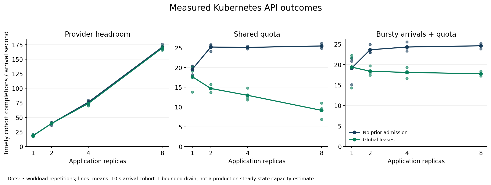
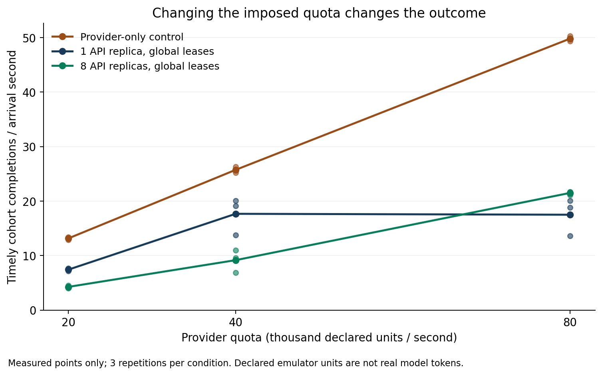
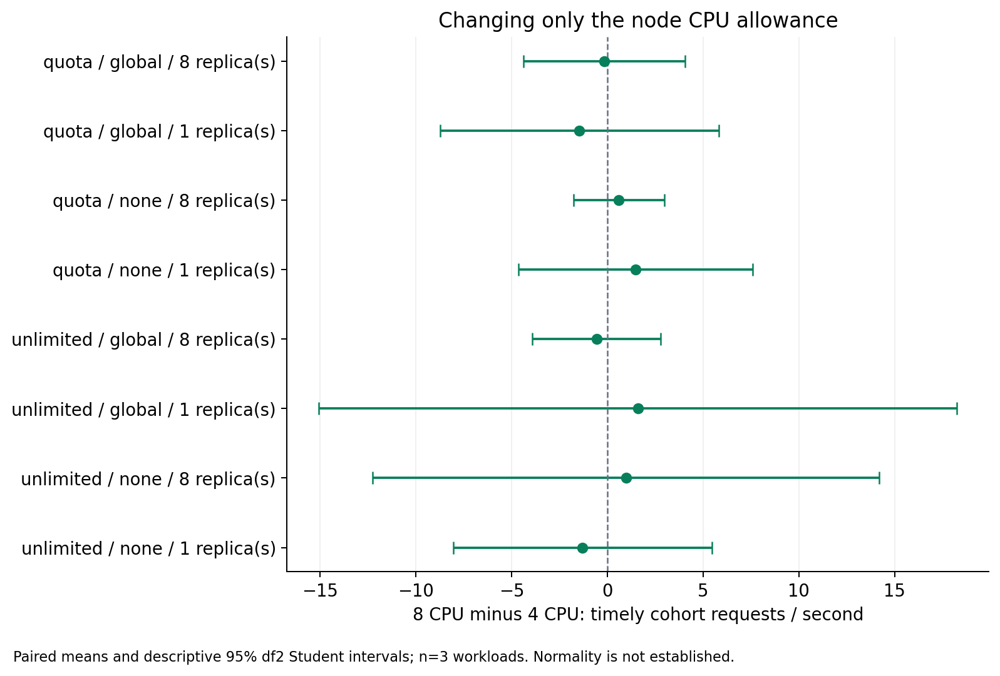
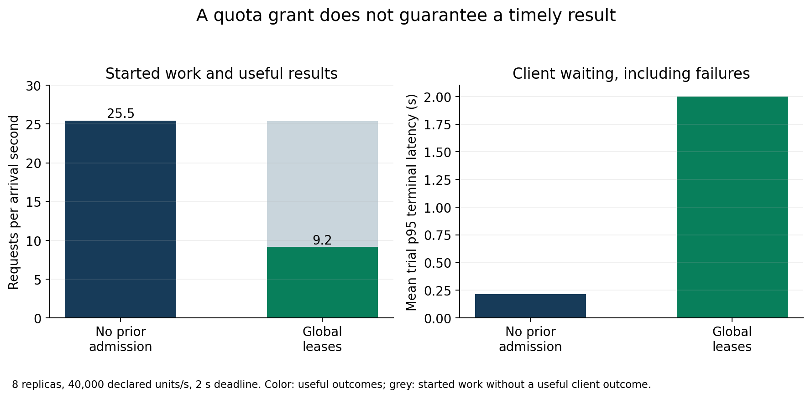

# Measured capacity, admission and validity results

The emulator supports a conditional conclusion: more application replicas help
when inference has headroom, but a shared quota sharply reduces that benefit.
The implemented global lease policy uses the quota correctly yet reduces timely
client outcomes under saturation. The real-model comparison remains unresolved:
actual local generations were collected, but their entire 45-trial block failed
qualification; the separate Linux-to-Mac continuation stopped at its transport
gates. No HPA/KEDA comparison has been measured.

Historical 12 November observations remain unchanged. New observations retain their
actual 13 November timestamps and executed source identities. This report does not
turn software tests, a successful workflow or an invalid measurement into proof
of an architectural claim.

## What was collected

| New cohort | Trials | Passing trials | Use |
| --- | ---: | ---: | --- |
| Local 4 CPU qualification |12 |7 | Whole block excluded |
| Local 8 CPU qualification |12 |5 | Whole block excluded |
| GitHub Linux 4 CPU qualification |12 |12 | Passed |
| Linux provider-only controls |12 |12 | Quota counterfactual |
| Linux primary matrix |72 |72 | H1–H3 exploratory comparisons |
| Linux 20k/80k quota sensitivity |12 |12 | Quota sensitivity |
| Independent VM4 CPU qualification |12 |12 | Passed |
| Independent VM8 CPU qualification |12 |12 | Passed |
| Independent VM CPU sensitivity |48 |48 | Paired 4/8 CPU comparison |
| Local model-path zero-service qualification |12 |12 | Preliminary headroom only |
| Local actual Qwen comparison |45 |30 | Whole block excluded |

All 261 complete trial records, including all failures, are archived. An earlier
interrupted model-control attempt has no complete trial record and is retained
separately. The native pilot contains four warmup and 48 measured generations;
all 52 classifications are correct. The three remote transport blocks contain
three headroom repetitions each; none qualifies as a whole. No model comparison
was started after those failed gates.

The [generated condition tables](analysis/v2-study/tables.md),
[trial CSV](analysis/v2-study/trials.csv) and
[full analysis](analysis/v2-study/results.json) expose every condition, including
excluded blocks. [AUDIT.md](AUDIT.md) covers the original evidence.

## Measurement and uncertainty

The main reported rate is timely correct completions among arrivals in the
measurement window divided by that window's duration:10 seconds for the emulator,
20 seconds for the model. Each arrival has its own deadline and is followed through
a bounded drain. This is a finite arrival-cohort outcome, **not a sustainable
steady-state production capacity**. Completions occurring during the window are
reported separately. At eight unlimited workers the cohort mean is 170.73/s,
whereas the during-window mean is 161.00/s; these are not interchangeable.

The controller retains planned, launched, socket-written and terminal times,
including non-emission and expiry. The source uses remaining-duration budgets
between roles and labelled clock domains. Stage spans use one worker's clock;
the native Mac and Linux clocks are never subtracted. Actual socket writes are
an observable emission proxy, not a packet capture at the remote NIC.

There are three paired workload seeds per condition. Intervals below use
Student's t with two degrees of freedom on trial-level paired differences.
They are descriptive: normality, independence and stable environment are not
established by three repetitions; there is no multiplicity-adjusted confirmatory
test. Requests are not resampled as independent experimental units. Complete
per-trial p50/p95/p99, their exact populations, failures and resource spans are
in each analysis JSON.

## H1: replicas with provider headroom

No prior admission, otherwise identical workload and resources:

| Application replicas | Useful cohort rate, three trials (/s) | Mean (/s) |
| ---: | --- | ---: |
|1 |20.3 /18.1 /18.2 |18.87 |
|2 |41.1 /36.4 /41.4 |39.63 |
|4 |77.6 /71.8 /79.4 |76.27 |
|8 |175.7 /169.1 /167.4 |170.73 |

| Paired change | Added useful/s, mean [descriptive 95% interval] | Mean per additional replica |
| --- | ---: | ---: |
|1→2 |20.77 [14.68,26.85] |20.77 |
|2→4 |36.63 [33.39,39.88] |18.32 |
|4→8 |94.47 [80.52,108.41] |23.62 |

Additional workers materially improve this finite-workload outcome. There is no
observed monotonic decline in marginal benefit through eight workers. Eight
workers already finish about 97% of offered measurement arrivals on time; the
experiment cannot locate a scalability knee beyond that offered load or beyond
eight replicas. Queueing, drops, service tails and deadlines make these values
different from a universal per-pod capacity constant.

## H2: changing the suspected limiting factor

At 40,000 declared units/s, increasing workers from one to eight without prior
admission adds 5.87 useful/s [3.97,7.76], compared with 151.87/s [143.94,159.79]
under provider headroom. The eight-worker quota mean is 25.47/s.

The provider-only control bypasses application workers while keeping the same
arrivals and declared-unit distribution:

| Quota (declared units/s) | Useful/s, three trials | Mean |
| ---: | --- | ---: |
|20,000 |12.9 /13.2 /13.4 |13.17 |
|40,000 |25.7 /25.2 /26.3 |25.73 |
|80,000 |50.3 /49.8 /49.3 |49.80 |
|1,000,000,000 |178.8 /178.4 /170.7 |175.97 |

Moving the quota moves this outcome while the same generator demonstrates
headroom. With eight globally regulated workers,20k/40k/80k quotas produce
4.27/9.17/21.50 useful/s. Their much lower efficiency is an admission-policy
outcome, not the isolated provider ceiling.

The independent 8 vCPU VM supplies a second counterfactual: change only the kind
node's allowance between 4 and 8 CPU, using 48 randomized paired trials after both
12-trial qualifications pass. For eight unregulated workers the paired effect
is+0.97 useful/s [−12.27,14.20] with headroom and+0.60/s [−1.77,2.97] with quota.
The intervals do not establish equivalence or rule out smaller CPU effects.
They do not support a large CPU-driven displacement of this quota plateau.

All CPU contrasts are in the generated analysis. The VM shows roughly 1–2% steal
in the illustrated conditions, and no node-cgroup throttled-time increment in
those trials. This is a shared hypervisor, not dedicated bare metal. The earlier
GitHub cohort and this VM use different hardware and source checkpoints and are
not pooled into a single causal CPU estimate. V2's later trial-binding guard is
a prospective integrity improvement, not evidence that earlier trials were
contaminated.

Together, quota manipulation, provider bypass, actual-emission qualification,
resource observations and the CPU counterfactual strongly support the imposed
quota as the principal constraint in these emulator conditions. They do not
exclude all network, scheduling or platform effects in other environments.

## H3: correct reservations can still deliver the wrong work too late

The provider-owned lease ledger passes accounting replay: each consumed
reservation corresponds to one inference, no window exceeds either quota, and
no primary request is executed twice. This fixes the original independent
admission/provider counters. Correct accounting alone does not ensure a useful
service policy.

For eight workers and 40k quota:

| Outcome | No prior admission | Global leases |
| --- | ---: | ---: |
| Mean useful/s |25.47 |9.17 |
| Mean timely useful fraction |14.48% |5.22% |
| Consumed measurement requests, three trials |764 |762 |
| Consumed without timely client outcome |0 |487 (63.91%) |
| Mean full provider-window unit utilization |98.90% |99.01% |
| Mean trial p95 client terminal latency |≈0.215s |≈2.001s |

The paired useful-rate effect of global versus no prior admission is
−16.30/s [−22.97,−9.63]; the useful-fraction effect is−9.26 percentage points
[−12.92,−5.60]. Global regulation moves provider refusals into worker queue
refusals and client expirations. Queue p95 is about 1.93 seconds and admission
p95 about 0.36 seconds, against a 2 second client deadline. These percentiles must
not be added as though they described the same request.

A source-linked illustration selects the median worker duration among the 178
consumed-but-unsuccessful, non-tail requests in the registered quota/global/8/
repetition 0 condition. Request `unlimited:0:1776` waits 1.810s in the worker queue,
0.140s for admission and 0.147s for its provider call. The provider produces a
correct 200 response, but the client has already expired at 2.001s. Its record is
in [the raw trial](archives/v2-linux-primary/primary-a8cd65769fffe9cb.json.gz).
This post hoc example illustrates timing; the 487/762 count establishes prevalence.

The implementation keeps four active slots per worker while waiting for leases,
plus a 32-entry bounded queue, and does not schedule by deadline feasibility.
The measured waiting spans identify that mechanism. H3's proposed improvement
is not supported for this policy under this workload. This is not evidence
against every coordinated admission strategy. A deadline-aware policy needs a
new frozen implementation and paired experiment; the negative results must
remain in the repository.

## H4: real generations exist, but transfer remains unqualified

The native pilot uses Apple M4 Max,16 logical CPU,128 GiB unified memory,
Ollama 0.40.16, Qwen 36B Q4_K_M, exact model digest
`07d35212591fc27746f0a317c975a6d68754fb38e9053d82e25f06057af28522`.
The dedicated server has four parallel slots, maximum queue 256, one loaded model
and 8192 context. Temperature 0, seed 20261112, output limit 32 and `think=false`
remain fixed. The API reports approximately 23.65 GB model/GPU residency; that is
an API placement observation on unified memory, not measured GPU energy.

Closed-loop pilot completion rates are 1.819/2.365/4.689 requests/s at
concurrency 1/2/4. These sequential warm-cache settings select low/near/high
open-loop rates 1.17/3.99/7.03/s; they are not a randomized causal concurrency
comparison. Rates and byte-identical traces were frozen before the 45 actual
direct/1/2/4/8-worker trials. The controlled HTTP-status classification task
does not represent the variety of production LLM workloads.

The local actual-model block finishes all 45 trials but 15 fail emission or
observation gates. Exclude the entire block, including its 30 passing trials.
Raw classifications and API-reported input/output counts, prefill/decode/load
durations, late work and failures remain replayable. They do not establish a
qualified capacity comparison. Moving clients to Linux was a diagnostic
continuation, not proof that a particular Mac, VM, GPU or scheduler caused the
earlier failure.

The independently hosted continuation stops before generation:

| Transport control | p95 latency, three headroom traces (ms) | Whole block |
| --- | --- | --- |
| Original SSH,26,490-byte model metadata |434 /619 /1061 | Failed |
| Compressed SSH, same metadata |99 /129 /183 | Failed |
| Compressed SSH,8 KiB high-entropy response fixture |118 /109 /135 | Failed |

All requests return successfully and emission p95 stays around 4 ms, but the
predeclared 100 ms response gate does not pass. The fixture sends actual frozen
generation bodies and returns a response larger than the maximum 5,590-byte
observed classification JSON. It is a network control with **no model inference**.
It does not rehabilitate the other controls. The source separately identifies
the added loopback proxy and native/VM clock domains. Neither thresholds nor
failed records were removed to obtain a model conclusion.

H4 remains open. A new attempt needs a qualified path or an independently
justified, newly registered validity design. These observations do not show
that the link's throughput is saturated; they show that this latency gate was
not met. Further repeated attempts chosen until one passes would be selection.

## Physical resources and confirmation planning

CPU seconds, cgroup throttling, sampled memory byte-seconds, observed replica
identities and per-stage queue/admission/provider spans are retained. Resource
intensities use whole-trace useful outcomes and their approximately matching
first-to-last observation spans, including warmup/drain; they are not falsely
assigned to only the 10 second cohort.

In the GitHub 40k/eight-worker condition, mean observed role CPU seconds per
whole-trace useful outcome are 0.0151 without prior admission and 0.0345 with
global leases. Mean observed role-memory exposure is 10.42 versus 23.16 MiB·s per
whole-trace useful outcome. This includes the generator/provider/worker process
roles; shared node/control-plane overhead is recorded separately. It measures
this run's accounting scope, not a billing rate or universal energy cost.
Separate VM hardware produces different CPU intensities and is not pooled.
Native inference CPU/RSS samples are likewise separate from VM CPU; missing GPU
energy and shared pages cannot be priced as zero.

For a future paired confirmation targeting 5 useful requests/s, observed-variance
normal approximations suggest at least 8/8/10 repetitions for the H1 adjacent
contrasts; using a 95% upper SD bound gives 37/11/193. The large range is a warning
about estimating variance from three seeds, not a prescribed 193-run campaign.
For H3 at eight quota workers, the corresponding conservative estimates are 45
repetitions for 5/s, or 14 for a 5-percentage-point useful-fraction effect. Freeze
one primary outcome, its effect size, environment and multiplicity handling in
a separate confirmation protocol. No paid inference or economic ROI is inferred.

## Scope that remains open

The [separate autoscaling design](studies/autoscaling/PROTOCOL.md) prepares
fixed/CPU-HPA/KEDA/provider-aware arms on 15 minute horizons. Its controller
installation, metric qualification and actual comparisons are not completed;
the historical repository autoscaler remains a prototype.

The emulator is a single-node kind system with controlled service times and
declared units. Real inference batching, long generation, cache reuse, GPU
compute, multi-node routing, network loss, reliability, fairness and sustained
production capacity remain outside the demonstrated conclusions. Model API
residual time is not identified as queue time; missing cache-token counts remain
unknown. A successful checksum replay proves reproducibility of the recorded
calculation, not scientific validity of an excluded block.
